  

 

# 🖥️ Awesome Remote Desktop Software

> A comprehensive, SEO-optimized, curated guide to **SaaS Remote Access Solutions** and **Open-Source Remote Desktop Software**. Spanning high-performance Remote Desktop Protocols (RDP), Virtual Network Computing (VNC), WebRTC clientless streaming, self-hosted sovereignty platforms, low-latency game streaming, and enterprise IT support tools.

---

## 📑 Table of Contents
- [🌐 Sector Overview & Market Dynamics](#-sector-overview--market-dynamics)
- [💼 Enterprise & Commercial SaaS Platforms](#-enterprise--commercial-saas-platforms)
- [🔓 Open-Source Remote Desktop Projects](#-open-source-remote-desktop-projects)
- [🛠️ Architectural Comparison & Selection Matrix](#️-architectural-comparison--selection-matrix)
- [🤝 How to Contribute](#-how-to-contribute)
- [⭐ Star History](#-star-history)
- [💖 Support & Community](#-support--community)
- [⚖️ Disclaimer](#️-disclaimer)

---

## 🌐 Sector Overview & Market Dynamics

The global **Remote Desktop Software** market is valued at approximately **$3.5 billion in 2025/2026** and is projected to surpass **$9.8 billion by 2032**, expanding at a Compound Annual Growth Rate (**CAGR**) of **~15.4%** across enterprise IT support, hybrid workforce enablement, and edge systems administration.

The industry exhibits **moderate-to-high fragmentation** rather than a winner-take-all monopoly. While established commercial giants (such as TeamViewer, BeyondTrust, and ConnectWise) hold significant defensive moats in regulated enterprise support and managed service provider (MSP) ecosystems, escalating seat-based subscription fees and stringent data-residency regulations have catalyzed a major paradigm shift toward **self-hosted, open-source infrastructures** (e.g., RustDesk, Apache Guacamole, and PiKVM). Consequently, the market remains split between high-compliance corporate SaaS offerings and community-driven self-hosted solutions.

---

## 💼 Enterprise & Commercial SaaS Platforms

Below is a detailed breakdown of the leading commercial remote desktop and unattended assistance platforms. Entries are sorted descending by **Company Size / Valuation**.

| 🏢 Product | 🔍 Overview & Key Capabilities | 📈 Company Size / Valuation | 🏷️ Starting Tier Pricing | 🎁 Free Tier / Trial Limits |
| :--- | :--- | :--- | :--- | :--- |
| **[Chrome Remote Desktop](https://remotedesktop.google.com/)** | Lightweight, browser-based remote access powered by Google WebRTC infrastructure. Ideal for quick ad-hoc desktop access without client installations. | **~$2.1 Trillion** *(Market Cap / Alphabet Inc.)* | **$0.00 / month** *(100% free with Google Account)* | **Free Forever** with unlimited sessions; supports up to 100 configured remote host devices per account. |
| **[Zoho Assist](https://www.zoho.com/assist/)** | Cloud-native remote support and unattended management platform tightly bundled with Zoho CRM, Desk, and enterprise ticketing tools. | **~$12.0 Billion** *(Valuation / ~$1.3B ARR)* | **$10.00 / tech / month** *(Billed annually at $120/yr for Remote Support Standard)* | **Free Forever Plan**: 1 technician, 5 unattended computers, 1 concurrent session (excludes file transfer & multi-monitor). |
| **[ConnectWise ScreenConnect](https://www.connectwise.com/)** | High-performance remote support, remote administration, and unattended endpoint monitoring engineered specifically for IT teams and MSPs. | **~$4.5 Billion** *(Valuation / Thoma Bravo)* | **$28.00 / month** *(Billed annually at $336/yr for "One" plan: 1 user, 10 unattended access agents)* | **14-Day Free Trial**: Full enterprise feature set, up to 3 technician licenses and 10 unattended endpoints, no credit card required. |
| **[BeyondTrust Remote Support](https://www.beyondtrust.com/)** | Enterprise-grade privileged remote support delivering granular role-based access control (RBAC), tamper-proof audit trails, and strict compliance security. | **~$3.0 Billion** *(Valuation / Francisco Partners)* | **~$174.75 / tech / month** *(Billed annually at $2,097/yr for base Concurrent License)* | **14-Day Free Trial**: Up to 5 concurrent technician licenses, session recording, and credential injection; no perpetual free tier. |
| **[TeamViewer](https://www.teamviewer.com/)** | Global market leader in remote connectivity offering 4K multi-monitor streaming, Wake-on-LAN, mobile screen mirroring, and cross-platform access. | **~$2.7 Billion** *(Market Cap / ETR: TMV)* | **$24.90 / month** *(Billed annually at $298.80/yr for "Remote Access" plan: 1 user, 3 devices)* | **Free for Personal Use**: Subject to automated commercial-use detection (frequently terminates sessions after 5 minutes); 14-day commercial trial. |
| **[Splashtop](https://www.splashtop.com/)** | Optimized high-frame-rate remote desktop engine supporting up to 60fps 4K streaming, low latency, and specialized graphics tablet redirection. | **~$1.0 Billion** *(Valuation / Unicorn Status)* | **$5.00 / user / month** *(Billed annually at $60/yr for "Business Access Solo", up to 2 computers)* | **7-Day Free Trial**: Access up to 2 remote computers with full high-performance streaming, no credit card required. (Splashtop Personal is free on local LAN only). |
| **[AnyDesk](https://anydesk.com/)** | Fast, lightweight remote access powered by the proprietary DeskRT video codec, ensuring ultra-low bandwidth consumption and high frame-rate response. | **~$660 Million** *(Valuation / Series C)* | **$14.90 / month** *(Billed annually at $178.80/yr for "Solo" plan: 1 user, 3 managed devices)* | **Free for Personal Use**: Limited to 3 assigned devices with interstitial connection wait countdowns; 14-day enterprise trial. |
| **[RealVNC Connect](https://www.realvnc.com/)** | Commercial-grade VNC implementation providing cloud-brokered and direct peer-to-peer RFB connectivity with end-to-end 256-bit AES encryption. | **~$200 Million** *(Valuation / Livingbridge)* | **$3.69 / device / month** *(Billed annually at $44.28/yr, min. 3 devices = $132.84/yr for "Essentials")* | **14-Day Free Trial**: Unlimited device connections and cloud-brokered sessions, no credit card required. (Legacy free tier retired). |
| **[APE Viewer](https://apeviewer.com/)** | Proprietary remote desktop for Windows 10/11 on both PCs. Premium opens every monitor together, each in its own window. Sound, shared clipboard and Xbox-style controllers work on Free too. | Independent developer; no public valuation. | **$6.99 / month** or **$49 / year** (Premium launch price) | **Free**: 1 shared PC, 1 person, 1 screen at a time, no time limit. New subscribers get a **1-day Premium trial**, once per person. |

---

## 🔓 Open-Source Remote Desktop Projects

A rich collection of self-hosted, sovereign, and privacy-respecting remote desktop software, protocol implementations, and hardware KVM solutions. Repositories are strictly ordered **descending by GitHub star count**.

### 1. [scrcpy](https://github.com/Genymobile/scrcpy) 
- **Primary Protocol**: Android ADB / H.264 / H.265 / AV1 streaming over USB or TCP/IP.
- **Key Features**: Ultra-low latency (35–70 ms), 60+ FPS performance, no root access required, virtual display mirroring, physical keyboard/mouse simulation, and audio forwarding.
- **License**: Apache-2.0

### 2. [RustDesk](https://github.com/rustdesk/rustdesk) 
- **Primary Protocol**: Custom Rust-based WebRTC / Rendezvous / Relay protocol.
- **Key Features**: The premier open-source alternative to TeamViewer and AnyDesk. Features end-to-end encryption, multi-platform native clients (Windows, macOS, Linux, Android, iOS, Web), unattended access, two-way clipboard sync, multi-monitor switching, and seamless Docker self-hosting.
- **License**: AGPL-3.0

### 3. [Sunshine](https://github.com/LizardByte/Sunshine) 
- **Primary Protocol**: NVENC / AMD AMF / Intel QuickSync / Software low-latency stream.
- **Key Features**: Self-hosted, low-latency game stream and high-performance remote desktop server compatible with Moonlight clients. Supports hardware acceleration across all major GPUs, virtual display creation, HDR streaming, and gamepad/mouse/keyboard passthrough.
- **License**: GPL-3.0

### 4. [Barrier](https://github.com/debauchee/barrier) 
- **Primary Protocol**: Network KVM sharing protocol with TLS/SSL encryption.
- **Key Features**: Software KVM switch allowing seamless cursor, keyboard, and clipboard movement across multiple physical machines and displays running different operating systems over the local network.
- **License**: GPL-2.0

### 5. [Deskreen](https://github.com/pavlobu/deskreen) 
- **Primary Protocol**: WebRTC video stream over standard web browsers.
- **Key Features**: Transforms any device with a modern web browser (phone, tablet, smart TV, or secondary laptop) into an extended secondary monitor or mirrored remote desktop display with end-to-end encryption.
- **License**: AGPL-3.0

### 6. [Moonlight](https://github.com/moonlight-stream/moonlight-qt) 
- **Primary Protocol**: GameStream / Sunshine protocol implementation.
- **Key Features**: Open-source client for low-latency streaming of games and desktops from Sunshine or NVIDIA GameStream hosts. Supports 4K 120 FPS, HDR, 5.1/7.1 surround sound, and negligible input delay.
- **License**: GPL-3.0

### 7. [noVNC](https://github.com/novnc/noVNC) 
- **Primary Protocol**: HTML5 Canvas and WebSockets VNC (RFB).
- **Key Features**: Pure JavaScript and HTML5 browser client for VNC. Requires zero plugins or installed binaries on client machines; widely integrated into Proxmox VE, OpenStack, and container web dashboards.
- **License**: MPL-2.0

### 8. [FreeRDP](https://github.com/FreeRDP/FreeRDP) 
- **Primary Protocol**: Microsoft Remote Desktop Protocol (RDP) specification.
- **Key Features**: High-performance, portable implementation of RDP serving as the core engine behind numerous commercial and open-source clients. Supports RemoteFX, audio redirection, clipboard sharing, and multi-monitor layouts.
- **License**: Apache-2.0

### 9. [PiKVM](https://github.com/pikvm/pikvm) 
- **Primary Protocol**: Hardware IP-KVM over WebRTC / MJPEG / H.264.
- **Key Features**: Cost-effective, Raspberry Pi-based DIY IP-KVM hardware and OS. Offers BIOS-level access, virtual drive mounting (ISO images), hardware ATX power control (reset/power buttons), and keyboard/mouse emulation.
- **License**: GPL-3.0

### 10. [Input Leap](https://github.com/input-leap/input-leap) 
- **Primary Protocol**: TLS-secured peer-to-peer mouse/keyboard sharing.
- **Key Features**: Active continuation of Synergy and Barrier. Facilitates virtual multi-system desktop interaction with seamless cross-platform clipboard syncing and drag-and-drop file transfers.
- **License**: GPL-2.0

### 11. [TigerVNC](https://github.com/TigerVNC/tigervnc) 
- **Primary Protocol**: Virtual Network Computing / Remote FrameBuffer (RFB).
- **Key Features**: The reference high-speed multi-platform VNC server and client implementation, providing optimized JPEG compression and full TLS encryption extensions.
- **License**: GPL-2.0

### 12. [MeshCentral](https://github.com/Ylianst/MeshCentral) 
- **Primary Protocol**: Web-based remote management agent over WebSockets / Intel AMT.
- **Key Features**: Complete self-hosted web console for IT administrators. Manages fleets of computers across NAT barriers, providing remote desktop, file explorer, shell terminal, power state control, and hardware Intel AMT KVM.
- **License**: Apache-2.0

### 13. [xrdp](https://github.com/neutrinolabs/xrdp) 
- **Primary Protocol**: Remote Desktop Protocol (RDP) Server for Linux.
- **Key Features**: Provides a native RDP server for X11/Wayland desktops, enabling Microsoft Remote Desktop Connection (`mstsc.exe`) clients to log into Linux graphical sessions seamlessly.
- **License**: Apache-2.0

### 14. [KasmVNC](https://github.com/kasmtech/KasmVNC) 
- **Primary Protocol**: Web-native RFB with WebRTC, JPEG-Turbo, and H.264/WebP encoding.
- **Key Features**: Next-generation VNC server designed specifically for modern web browsers. Eliminates the need for intermediary WebSocket proxies and provides adaptive bandwidth throttling and touch-friendly controls.
- **License**: GPL-2.0

### 15. [Remotely](https://github.com/immense/Remotely) 
- **Primary Protocol**: .NET / WebRTC self-hosted remote control.
- **Key Features**: Self-hosted remote desktop, remote scripting, and automated systems management platform designed as a lightweight open-source RMM suite.
- **License**: AGPL-3.0

### 16. [Apache Guacamole](https://github.com/apache/guacamole-server) 
- **Primary Protocol**: Clientless HTML5 gateway bridging RDP, VNC, and SSH.
- **Key Features**: The standard clientless remote desktop gateway. Desktops and servers are rendered directly in HTML5 browsers without client plugins. Features centralized authentication (LDAP, SAML, Duo, TOTP) and wake-on-LAN.
- **License**: Apache-2.0

### 17. [TinyPilot](https://github.com/tiny-pilot/tinypilot) 
- **Primary Protocol**: Browser-based IP-KVM over H.264 / WebSockets.
- **Key Features**: Turnkey hardware KVM-over-IP solution built for single-board computers (Raspberry Pi). Provides low-latency out-of-band management and BIOS keyboard/video/mouse control.
- **License**: GPL-3.0

### 18. [Remmina](https://github.com/FreeRDP/Remmina) 
- **Primary Protocol**: Multi-protocol client (RDP, VNC, SPICE, SSH, EXEC).
- **Key Features**: The standard graphical remote desktop client for Linux and BSD systems. Features an organized connection profile manager, SSH tunneling, multi-display scaling, and tray integration.
- **License**: GPL-2.0

### 19. [Aspia](https://github.com/dchapyshev/aspia) 
- **Primary Protocol**: Proprietary encrypted binary protocol with NAT traversal routers.
- **Key Features**: Complete remote desktop and remote assistance management suite featuring an encrypted address book, system hardware profiler, file manager, audio streaming, and session recording.
- **License**: GPL-3.0

### 20. [wayvnc](https://github.com/any1/wayvnc) 
- **Primary Protocol**: RFB / VNC server for Wayland compositors.
- **Key Features**: VNC server engineered specifically for wlroots-based Wayland desktop environments (such as Sway and Wayfire), delivering hardware-accelerated screen capture and smooth input handling.
- **License**: ISC

### 21. [LibVNCServer](https://github.com/LibVNC/libvncserver) 
- **Primary Protocol**: Core C library implementing RFB (Remote FrameBuffer).
- **Key Features**: Foundational cross-platform C library utilized by dozens of remote desktop and virtualization tools to implement custom VNC servers and clients.
- **License**: GPL-2.0

### 22. [TurboVNC](https://github.com/turbovnc/turbovnc) 
- **Primary Protocol**: Highly tuned VNC with libjpeg-turbo acceleration.
- **Key Features**: High-performance VNC variant tuned for 3D visualization, video processing, and CAD/CAM engineering applications, commonly paired with VirtualGL.
- **License**: GPL-2.0

### 23. [ZConect](https://github.com/zahar24ru/ZConect) 
- **Primary Protocol**: WebRTC with ICE (LAN → STUN → TURN) multi-relay failover.
- **Key Features**: Lightweight remote desktop with strict zero-knowledge telemetry, end-to-end encryption, multi-factor session validation, and two-panel file transfer.
- **License**: MIT

### 24. [ScottiBYTE Assist](https://github.com/scottibyte/scottibyte-assist) 
- **Primary Protocol**: Attended WebSocket / Opus audio remote support protocol.
- **Key Features**: Explicit attended support system requiring customer approval via 6-digit session codes, integrated two-way voice chat, remote terminal, and complete audit logging.
- **License**: GPL-3.0

---

## 🛠️ Architectural Comparison & Selection Matrix

| Use Case | Recommended Platform | Why It Fits |
| :--- | :--- | :--- |
| **All-in-One TeamViewer Replacement** | **RustDesk** | Native apps on all platforms, built-in NAT punchthrough, and turnkey Docker self-hosting. |
| **Zero-Install Clientless Access** | **Apache Guacamole** | Full HTML5 browser gateway with enterprise LDAP/SAML integration and zero client requirements. |
| **Out-of-Band & Hardware Recovery** | **PiKVM / TinyPilot** | Hardware-level BIOS control, virtual ISO attachment, and hard-reset capability across network boundaries. |
| **Ultra Low-Latency Gaming & 3D Work** | **Sunshine + Moonlight** | Sub-15ms latency, 60–120 FPS, 4K HDR support, and full gamepad/graphics tablet passthrough. |
| **Multi-PC Peripheral Sharing (KVM)** | **Barrier / Input Leap** | Seamless single mouse/keyboard control across distinct physical workstations. |
| **Enterprise MSP & Helpdesk** | **ConnectWise / BeyondTrust** | Audited credential injection, technician concurrency licensing, and compliance reporting. |

---

## 🤝 How to Contribute

Contributions from developers, sysadmins, and homelabbers are welcome!
1. **Fork the repository** to your personal GitHub account.
2. **Add or modify entries** in `README.md` adhering to the established schema and ranking metrics.
3. **Verify criteria**: Provide official project links, exact starting tier prices for commercial tools, and repository stargazer links for open-source entries.
4. **Submit a Pull Request** with a concise explanation of your additions or revisions.

---

## ⭐ Star History

---

## 💖 Support & Community

Thank you for visiting and using **Awesome Remote Desktop Software**! If this repository helped streamline your IT infrastructure, homelab setup, or remote support workflows, please consider supporting the project:

- ⭐ **Star this repository** to improve its visibility and help other developers and sysadmins discover it.
- 🍴 **Fork and contribute** by adding emerging open-source remote tools, reporting benchmark shifts, or correcting data.
- 📢 **Share this list** with your colleagues, DevOps communities, and homelab groups.
- ☕ **Sponsor / Buy me a coffee**: Back ongoing curation and open-source research through the [GitHub Sponsor Dashboard](https://github.com/sponsors/ishandutta2007).

Your encouragement and support keep this ecosystem actively maintained and accurate!

---

## ⚖️ Disclaimer

- This is an independent, **community-curated** educational guide and does not represent an endorsement of any listed commercial vendor.
- Remote access tools vary dramatically in licensing, encryption strength, and network exposure. **Self-hosted software shifts operational security to you**: ensure robust reverse proxies with TLS termination, WebSockets hardening, and multi-factor authentication are enforced across all endpoints.
- Pricing and plan limits reflect publicly available rates and are subject to vendor changes.

---

  Maintained with ❤️ by <a href="https://github.com/ishandutta2007">Ishan Dutta</a> and the global open-source community.

